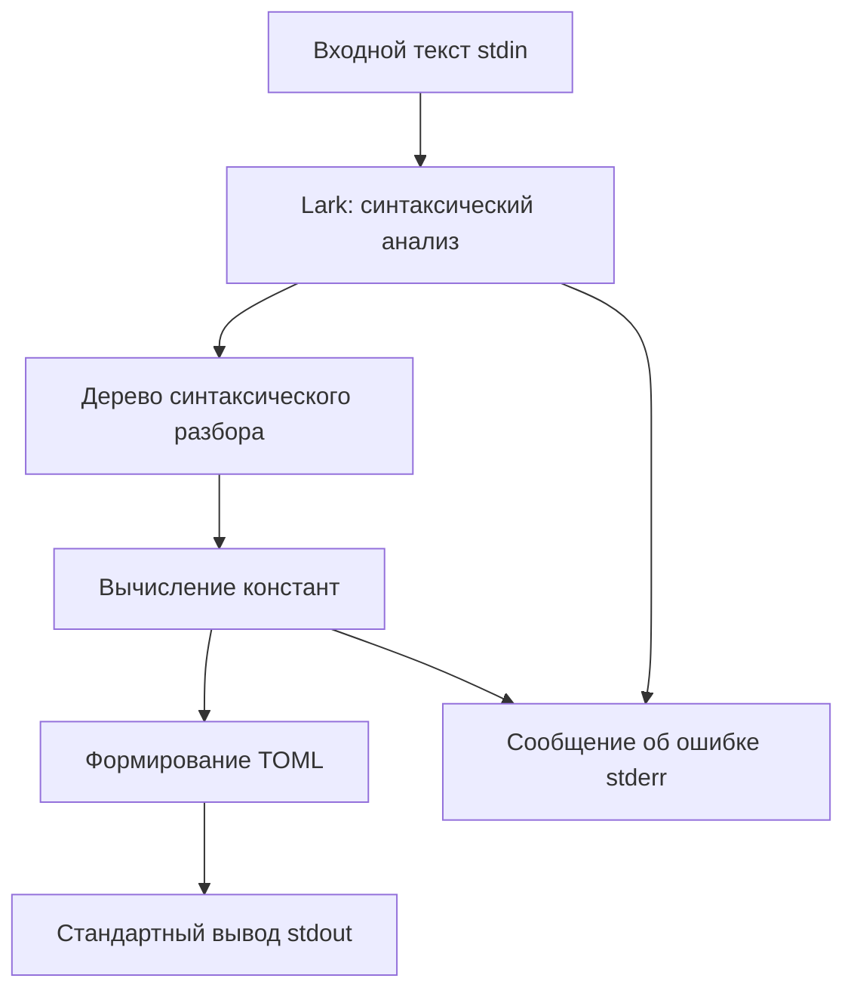

# Транслятор конфигурационного языка в TOML

Домашняя работа по дисциплине
«Конфигурационное управление».

**Вариант №22**

## Общее описание

Проект представляет собой инструмент командной строки
для преобразования учебного конфигурационного языка в TOML.

Входные данные принимаются из стандартного ввода (stdin).
Результат трансляции выводится в стандартный вывод (stdout).
Сообщения об ошибках направляются в stderr.

Для синтаксического анализа используется библиотека Lark
и алгоритм Earley.

## Возможности

- Однострочные комментарии.
- Многострочные комментарии.
- Числа в экспоненциальной форме.
- Массивы.
- Словари.
- Вложенные конструкции.
- Объявление констант.
- Подстановка констант.
- Префиксное сложение.
- Префиксное вычитание.
- Сортировка массивов.
- Формирование TOML.
- Обработка синтаксических и семантических ошибок.

## Архитектура



## Синтаксис языка

### Однострочный комментарий

```text
C Это комментарий
```

### Многострочный комментарий

```text
/+
Это многострочный
комментарий
+/
```

Комментарии не влияют на результат трансляции.

### Числа

Числа задаются регулярным выражением:

```text
[+-]?\d+\.?\d*[eE][+-]?\d+
```

Примеры:

```text
1e3
-2.5e-1
+3.2E+2
0e0
```

Числа обрабатываются как значения типа float.
Неконечные результаты отклоняются.

### Имена

Допустимы только строчные латинские буквы:

```text
[a-z]+
```

Примеры:

```text
port
timeout
server
```

### Массивы

```text
(list 1e0 2e0 3e0)
```

Результат:

```toml
value = [1.0, 2.0, 3.0]
```

Массивы могут содержать другие массивы и словари.

### Словари

```text
begin
    port := 8e3;
    timeout := 3e1;
end
```

Результат:

```toml
port = 8000.0
timeout = 30.0
```

Словари могут быть вложенными.

### Объявление констант

```text
(define base 1e2)
```

Константы объявляются перед итоговым значением.
Повторное объявление константы запрещено.
Константа должна быть объявлена до её использования.

### Подстановка константы

```text
(define base 1e2)
begin
    result := {base};
end
```

Результат:

```toml
result = 100.0
```

### Сложение

```text
(define base 1e2)
begin
    result := {+ base 20};
end
```

Результат:

```toml
result = 120.0
```

### Вычитание

```text
(define base 1e2)
begin
    result := {- base 20};
end
```

Результат:

```toml
result = 80.0
```

### Сортировка

Функция sort записывается в префиксной форме.

```text
(define numbers (list 3e0 1e0 2e0))
begin
    result := {sort numbers};
end
```

Результат:

```toml
result = [1.0, 2.0, 3.0]
```

Сортировка производится по возрастанию.
Поддерживаются числовые массивы.
Исходная константа не изменяется.

### Вложенные выражения

```text
(define base 1e1)
begin
    result := {+ base {- 8 3}};
end
```

Результат:

```toml
result = 15.0
```

## Особенности реализации

В методичке числа описаны в экспоненциальной форме,
но в примере константного выражения используется целое число.

Поэтому целые числа без показателя степени разрешены
в качестве операндов константных выражений.

Для сортировки выбрана запись `{sort имя}`.
Для непосредственной подстановки используется `{имя}`.

Документ состоит из объявлений констант
и одного итогового значения.

Если итоговым значением является число или массив,
оно записывается в TOML под ключом value.

Вложенные словари представляются встроенными таблицами TOML.

## Установка

Требуется Python версии 3.11 или новее.

Установка библиотеки синтаксического анализа:

```powershell
py -m pip install -r requirements.txt
```

Используется Lark версии 1.3.1.

Отдельная сборка проекта не требуется.

## Запуск программы

Запуск через скрипт:

```powershell
.\run.bat
```

Запуск напрямую:

```powershell
py -m src.main
```

Пример передачи текста через стандартный ввод:

```powershell
'begin port := 8e3; end' | .\run.bat
```

Результат:

```toml
port = 8000.0
```

## Пример 1. Конфигурация веб-сервера

Исходный файл:

`examples/server.cfg`

```text
C Web server configuration
(define base 8e3)
(define limits (list 5e2 1e2 3e2))
/+
Network settings and request limits
+/
begin
    server := begin
        port := {+ base 80};
        timeout := 3e1;
    end;
    limits := {sort limits};
end
```

Запуск:

```powershell
Get-Content examples\server.cfg -Raw | .\run.bat
```

Результат:

```toml
server = {port = 8080.0, timeout = 30.0}
limits = [100.0, 300.0, 500.0]
```

## Пример 2. Конфигурация склада

Исходный файл:

`examples/warehouse.cfg`

```text
C Warehouse configuration
(define stock 1.2e3)
(define sold 2e2)
begin
    available := {- stock sold};
    warehouse := begin
        capacity := 2e3;
        zones := (list
            begin
                capacity := 8e2;
            end
            begin
                capacity := 1.2e3;
            end
        );
    end;
end
```

Запуск:

```powershell
Get-Content examples\warehouse.cfg -Raw | .\run.bat
```

Результат:

```toml
available = 1000.0
warehouse = {capacity = 2000.0, zones = [{capacity = 800.0}, {capacity = 1200.0}]}
```

## Обработка ошибок

Программа обнаруживает:

- некорректные числа;
- недопустимые имена;
- неправильные разделители;
- незакрытые массивы и словари;
- незакрытые многострочные комментарии;
- отсутствие обязательных элементов;
- неизвестные константы;
- повторные объявления констант;
- повторяющиеся ключи словаря;
- неверные типы операндов;
- неподдерживаемые операции;
- выход чисел за допустимый диапазон.

Пример синтаксической ошибки:

```powershell
'begin port := 8e3 end' | .\run.bat
```

Пример семантической ошибки:

```powershell
'{+ unknown 1}' | .\run.bat
```

Сообщение:

```text
Ошибка: Неизвестная константа: unknown
```

При успешном выполнении код завершения равен 0.
При возникновении ошибки код завершения равен 1.

## Тестирование

Для тестирования используется unittest.

Запуск всех тестов:

```powershell
py -m unittest discover -s tests -v
```

Тесты транслятора:

```powershell
py -m unittest discover -s tests -p "test_translator.py" -v
```

Интеграционные тесты:

```powershell
py -m unittest discover -s tests -p "test_cli.py" -v
```

Проверяются все основные конструкции языка,
их вложенность, вычисления, ошибки и оба примера конфигураций.

Для проверки корректности выходного TOML
используется стандартная библиотека tomllib.

Результат:

```text
Ran 20 tests
OK
```

## Описание функций

### parser.py

- `parse_text()` — построение дерева синтаксического разбора.

### evaluator.py

- `finite_number()` — проверка конечности числа.
- `arithmetic()` — выполнение арифметической операции.
- `evaluate()` — вычисление дерева синтаксического разбора.

Методы класса Evaluator:

- `__init__()` — создание таблицы констант.
- `start()` — получение итогового значения.
- `number()` — преобразование числового литерала.
- `array()` — создание массива.
- `pair()` — создание пары ключа и значения.
- `dictionary()` — создание словаря.
- `definition()` — объявление константы.
- `reference()` — получение значения константы.
- `add()` — сложение.
- `subtract()` — вычитание.
- `sort_values()` — сортировка массива.

### translator.py

- `format_value()` — преобразование значения в TOML.
- `to_toml()` — создание документа TOML.
- `translate()` — выполнение полной трансляции.

### main.py

- `main()` — чтение stdin, запуск трансляции и вывод результата.

## Структура проекта

```text
config-management-translator/
├── src/
│   ├── __init__.py
│   ├── grammar.lark
│   ├── parser.py
│   ├── evaluator.py
│   ├── translator.py
│   └── main.py
├── tests/
│   ├── test_translator.py
│   └── test_cli.py
├── examples/
│   ├── server.cfg
│   └── warehouse.cfg
├── .gitignore
├── requirements.txt
├── run.bat
└── README.md
```

## Оформление репозитория

Служебные файлы Python, виртуальные окружения,
настройки редакторов и артефакты сборки исключены
через .gitignore.

В репозитории хранятся исходные файлы,
тесты, документация и текстовые примеры конфигураций.

## Вывод

Разработан транслятор учебного конфигурационного языка
в формат TOML для варианта №22.

Реализован специализированный синтаксический анализ,
вычисление константных выражений, вложенные конструкции,
обработка ошибок и консольный интерфейс.

Работа программы проверена автоматическими тестами
и примерами из двух различных предметных областей.